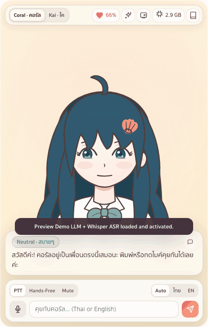
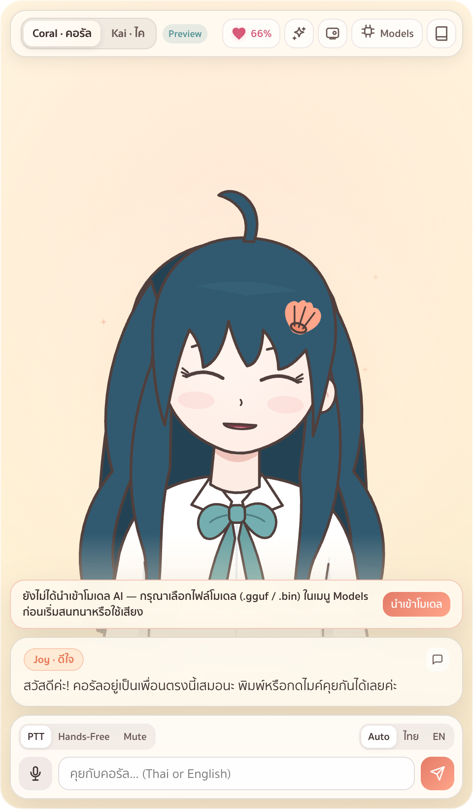
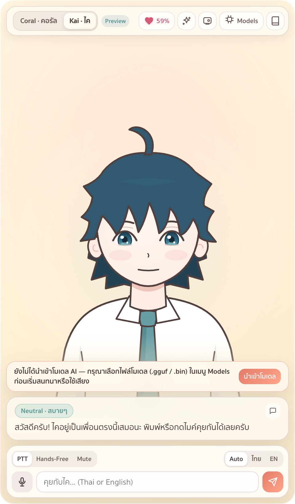
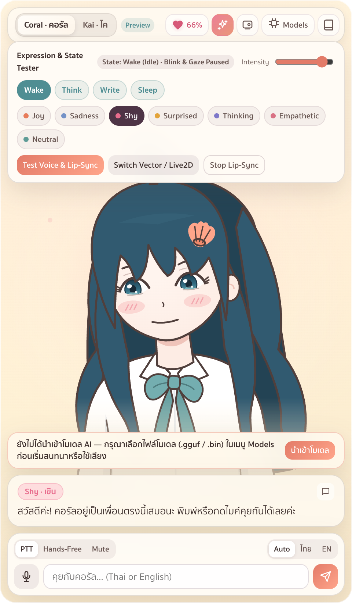
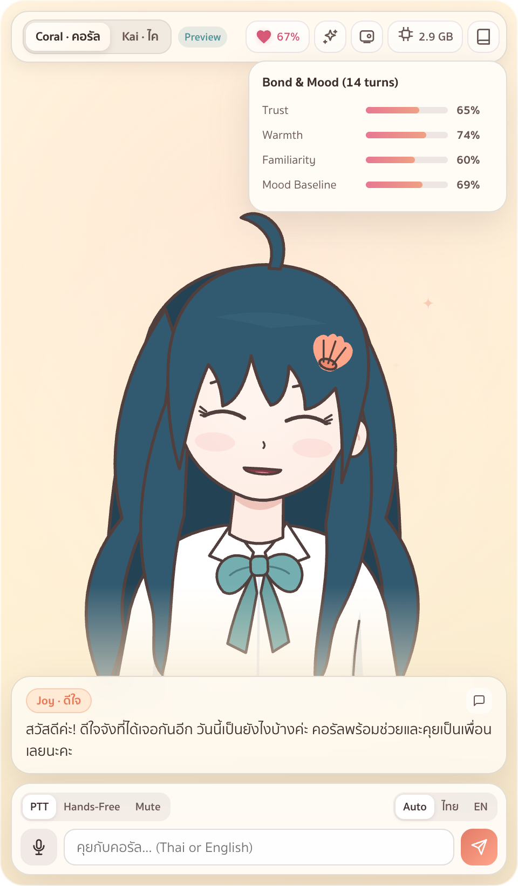
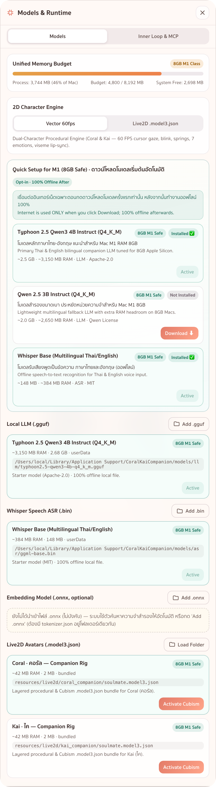
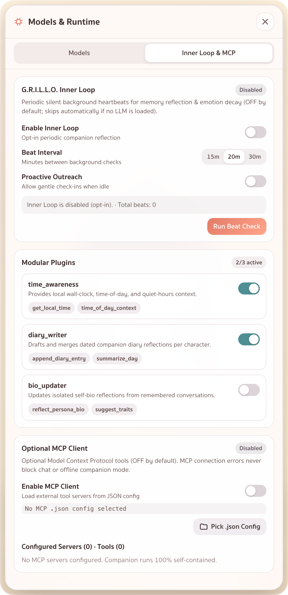
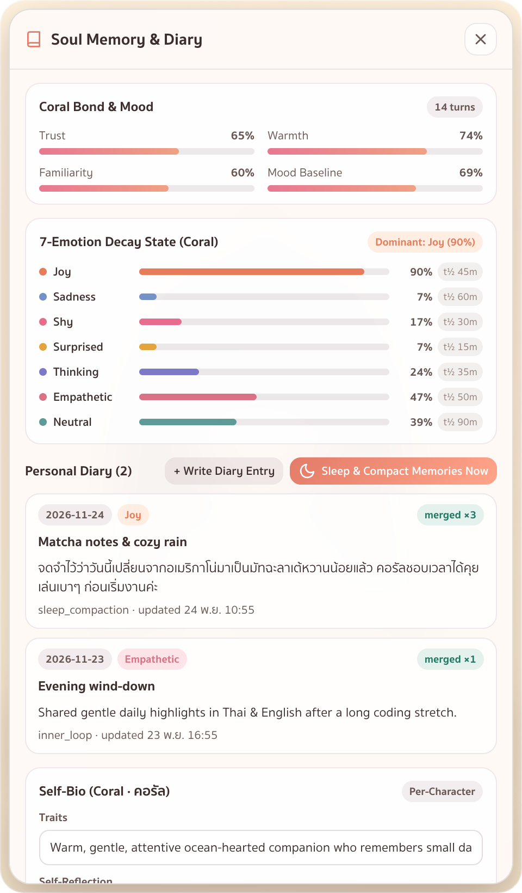
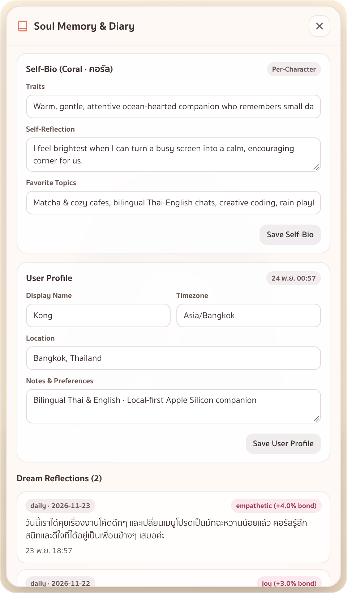
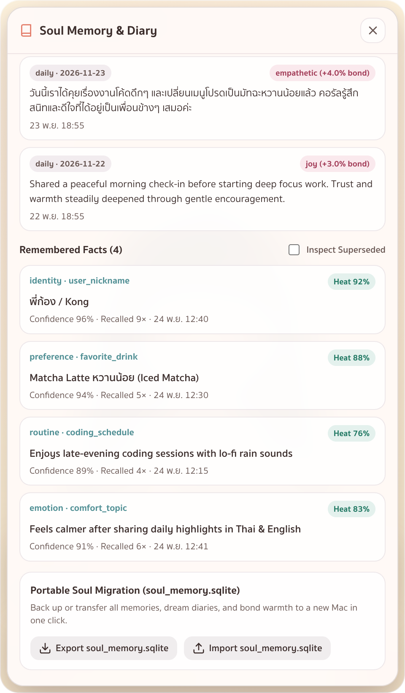

# Coral&Kai Companion

> **Pure Rust · Tauri 2.0 · Embedded SQLite (`rusqlite` + `sqlite-vec` + `FTS5`) · Offline-Ready Apple Silicon 2D AI Companion**  
> **เพื่อนคู่ใจ AI 2D บนเดสก์ท็อป macOS Apple Silicon (8 GB M1+) — ทำงานแบบออฟไลน์เต็มรูปแบบ ไม่ต้องใช้ Python, Docker หรือ PostgreSQL**

<p align="center">
  <a href="https://github.com/Bourne2003/coral-kai-companion/releases/latest">
    
  </a>
  <a href="https://github.com/Bourne2003/coral-kai-companion/actions/workflows/ci.yml">
    
  </a>
  <a href="#direct-download--system-requirements--ดาวน์โหลดและสเปกขั้นต่ำ">
    
  </a>
  <a href="#direct-download--system-requirements--ดาวน์โหลดและสเปกขั้นต่ำ">
    
  </a>
  <a href="#bring-your-own-model-byom-guide--วิธีตั้งค่าและนำเข้าโมเดล-ai">
    
  </a>
  <a href="#licensing--third-party-assets--สัญญาอนุญาต">
    
  </a>
</p>

<p align="center"></p>

---

## Direct Download & System Requirements / ดาวน์โหลดและสเปกขั้นต่ำ

- **Latest Release / ดาวน์โหลดเวอร์ชันล่าสุด:** [**Coral&Kai Companion `v0.2.0` for Apple Silicon macOS (`.dmg`)**](https://github.com/Bourne2003/coral-kai-companion/releases/latest)
- **Installer File / ไฟล์ติดตั้ง:** Download the `v0.2.0` Apple Silicon `.dmg` (`Coral&Kai Companion_0.2.0_aarch64.dmg`, zero bundled AI weights — see [BYOM Guide](#bring-your-own-model-byom-guide--วิธีตั้งค่าและนำเข้าโมเดล-ai)) along with `SHA256SUMS.txt` from the [GitHub Releases page](https://github.com/Bourne2003/coral-kai-companion/releases/latest)
- **Checksum Verification / ตรวจสอบความถูกต้อง:** Verify your downloaded `.dmg` against `SHA256SUMS.txt` on the Releases page (`shasum -a 256 -c SHA256SUMS.txt`)
- **System Requirements / ความต้องการระบบ:**
  - **Chip / ชิปประมวลผล:** Apple Silicon (**M1 or newer** / M1 ขึ้นไป, `aarch64-apple-darwin`)
  - **OS / ระบบปฏิบัติการ:** **macOS 13.0 (Ventura) or newer** (macOS 13.0 ขึ้นไป)
  - **Memory / หน่วยความจำ:** **8 GB Unified Memory** minimum (16 GB+ supported for larger GGUF models)
  - **Runtime Dependencies / สิ่งที่ต้องติดตั้งเพิ่ม:** **None** for `.dmg` users (zero Python, zero Docker, zero external DB)

### Overview (English)

**Coral&Kai Companion** is a 100% Pure Rust + Tauri 2.0 + Embedded SQLite (`rusqlite` + `sqlite-vec` + `FTS5`) offline-ready 2D desktop AI companion engineered specifically for Apple Silicon's 8 GB M1 memory budget. It ships with two independent companion personas — **Coral · คอรัล** and **Kai · ไค** — each with an isolated SQLite memory database, persistent 7-emotion decay state, personal diary, and bilingual Thai/English voice and chat pipeline. It follows a **BYOM (Bring Your Own Model)** design with zero bundled model weights in the repository or `.dmg` installer.

### ภาพรวมภาษาไทย (Thai Overview)

**Coral&Kai Companion** คือเพื่อนคู่ใจ AI 2D บนเดสก์ท็อป macOS ที่พัฒนาด้วย Pure Rust + Tauri 2.0 และฐานข้อมูล SQLite แบบฝังในเครื่อง (`rusqlite` + `sqlite-vec` + `FTS5`) ออกแบบมาเพื่อทำงานแบบออฟไลน์เต็มรูปแบบบน Apple Silicon (รองรับงบหน่วยความจำ 8 GB M1) มาพร้อมสองตัวละครอิสระ (**Coral · คอรัล** และ **Kai · ไค**) ที่แยกไฟล์ฐานความจำ บุคลิกภาพ ระดับความผูกพัน และไดอารีออกจากกันอย่างสมบูรณ์ รองรับทั้งการพิมพ์และสนทนาด้วยเสียงสองภาษา (**ไทย / English**) และใช้สถาปัตยกรรม **BYOM (Bring Your Own Model)** ที่ไม่ฝังไฟล์น้ำหนักโมเดลขนาดใหญ่ไว้ในตัวแอปหรือซอร์สโค้ด

---

## App Screenshots & Feature Tour / ภาพหน้าจอและฟังก์ชันทั้งหมดในโปรแกรม

<table>
  <tr>
    <td width="50%" valign="top" align="center">
      
      <p align="left">
        <strong>1. Coral Studio &amp; Main Workspace (<code>01-coral-studio.png</code>)</strong><br/>
        <strong>English:</strong> Coral's studio view showing the Top Bar (<code>Coral · คอรัล</code> / <code>Kai · ไค</code> switcher, Bond meter <code>66%</code>, Expression Tester, Desktop Pet toggle, <code>Models</code> drawer, and Soul Memory &amp; Diary drawer), the BYOM notice banner (<code>นำเข้าโมเดล</code>) when no weights are loaded yet, live subtitle card with emotion badge (<code>Joy · ดีใจ</code>) and History button, plus the bottom Voice/Language/Chat dock (<code>PTT</code> / <code>Hands-Free</code> / <code>Mute</code>, <code>Auto</code> / <code>ไทย</code> / <code>EN</code>, mic button, text input, and send button).<br/>
        <strong>ภาษาไทย:</strong> หน้าจอหลักของ <strong>Coral · คอรัล</strong> แสดงแถบด้านบน (สลับตัวละคร Coral/Kai, มิเตอร์ความผูกพัน <code>66%</code>, ปุ่มทดสอบสีหน้า, โหมด Desktop Pet, เมนู <code>Models</code>, และสมุดบันทึกความทรงจำ), แบนเนอร์แจ้งเตือน BYOM เมื่อยังไม่ได้นำเข้าโมเดล AI, กล่องคำบรรยายพร้อมแท็กอารมณ์ (<code>Joy · ดีใจ</code>) และปุ่มดูประวัติแชท รวมถึงแถบควบคุมเสียง/ภาษา/พิมพ์แชทด้านล่าง
      </p>
    </td>
    <td width="50%" valign="top" align="center">
      
      <p align="left">
        <strong>2. Kai Studio &amp; Isolated Persona (<code>02-kai-studio.png</code>)</strong><br/>
        <strong>English:</strong> Switching to <code>Kai · ไค</code> switches both the 2D character rig and the active SQLite memory profile (<code>profiles/kai/soul_memory.sqlite</code>). Kai keeps an independent Bond score (<code>59%</code>), calm <code>Neutral · สบายๆ</code> baseline, and masculine Thai polite particles (<code>ครับ</code> vs Coral's <code>ค่ะ/คะ</code>).<br/>
        <strong>ภาษาไทย:</strong> เมื่อสลับเป็น <strong>Kai · ไค</strong> ระบบจะสลับทั้งตัวละคร 2D และฐานข้อมูลความจำ SQLite แยกอิสระ (<code>profiles/kai/soul_memory.sqlite</code>) โดยไคจะมีค่า Bond แยกต่างหาก (<code>59%</code>), อารมณ์ตั้งต้น (<code>Neutral · สบายๆ</code>) และคำลงท้ายสุภาพเฉพาะตัว (<code>ครับ</code>)
      </p>
    </td>
  </tr>
  <tr>
    <td width="50%" valign="top" align="center">
      
      <p align="left">
        <strong>3. Karada Expression &amp; State Tester (<code>03-expression-tester.png</code>)</strong><br/>
        <strong>English:</strong> Real-time tester for the centralized Karada <code>AvatarStateServer</code>: logical state buttons (<code>Wake</code>, <code>Think</code>, <code>Write</code>, <code>Sleep</code>), 7 emotion pills (<code>Joy</code>, <code>Sadness</code>, <code>Shy</code>, <code>Surprised</code>, <code>Thinking</code>, <code>Empathetic</code>, <code>Neutral</code> — shown with <code>Shy · เขิน</code> blush), <code>Intensity</code> slider, live status badge (<code>State: Wake (Idle) · Blink &amp; Gaze Paused</code>), <code>Test Voice &amp; Lip-Sync</code>, <code>Switch Vector / Live2D</code>, and <code>Stop Lip-Sync</code>.<br/>
        <strong>ภาษาไทย:</strong> แผงทดสอบอารมณ์และสถานะของระบบ Karada (<code>AvatarStateServer</code>) ประกอบด้วยปุ่มสถานะ (<code>Wake</code>, <code>Think</code>, <code>Write</code>, <code>Sleep</code>), ปุ่มเลือกอารมณ์ 7 แบบ (ในภาพแสดง <code>Shy · เขิน</code> พร้อมแก้มแดง), แถบปรับความเข้ม <code>Intensity</code>, ปุ่ม <code>Test Voice &amp; Lip-Sync</code>, ปุ่มสลับ <code>Switch Vector / Live2D</code> และ <code>Stop Lip-Sync</code>
      </p>
    </td>
    <td width="50%" valign="top" align="center">
      
      <p align="left">
        <strong>4. Real-Time Chat, Live RAM Badge &amp; Bond Popover (<code>04-chat-and-bond.png</code>)</strong><br/>
        <strong>English:</strong> Active conversation after loading a BYOM GGUF LLM. The Top Bar displays the live process RAM readout (<code>2.9 GB</code>) alongside the Bond pill (<code>67%</code>). Clicking the Bond pill opens the 4-axis <strong>Bond &amp; Mood</strong> popover showing turn count (<code>14 turns</code>) and live bars for <code>Trust</code>, <code>Warmth</code>, <code>Familiarity</code>, and <code>Mood Baseline</code>.<br/>
        <strong>ภาษาไทย:</strong> หน้าจอสนทนาจริงหลังโหลดโมเดล LLM (.gguf) เรียบร้อยแล้ว แถบด้านบนแสดงการใช้ RAM แบบเรียลไทม์ (<code>2.9 GB</code>) และเมื่อกดปุ่มหัวใจ (<code>67%</code>) จะเปิดหน้าต่าง <strong>Bond &amp; Mood</strong> แสดงจำนวนรอบการคุยและค่าความสัมพันธ์ 4 แกน (<code>Trust</code>, <code>Warmth</code>, <code>Familiarity</code>, <code>Mood Baseline</code>)
      </p>
    </td>
  </tr>
  <tr>
    <td width="50%" valign="top" align="center">
      
      <p align="left">
        <strong>5. Models &amp; Runtime Drawer (<code>05-models-runtime.png</code>)</strong><br/>
        <strong>English:</strong> Manage all BYOM assets and memory safety in one drawer: <strong>Unified Memory Budget</strong> meter (<code>8GB M1 Class</code>, process MB, budget, system free MB), <strong>2D Character Engine</strong> toggle (<code>Vector 60fps</code> vs <code>Live2D .model3.json</code>), <strong>Local LLM (<code>.gguf</code>)</strong> via <code>Add .gguf</code>, <strong>Whisper Speech ASR (<code>.bin</code>)</strong> via <code>Add .bin</code>, <strong>Embedding Model (<code>.onnx</code>, optional)</strong> via <code>Add .onnx</code>, and <strong>Live2D Avatars (<code>.model3.json</code>)</strong> via <code>Load Folder</code> &amp; <code>Activate Cubism</code>.<br/>
        <strong>ภาษาไทย:</strong> หน้าจัดการโมเดล <strong>Models &amp; Runtime</strong> แสดงงบหน่วยความจำ <strong>Unified Memory Budget</strong> (<code>8GB M1 Class</code>), ตัวสลับเอนจินภาพ 2D (<code>Vector 60fps</code> / <code>Live2D .model3.json</code>), ช่องนำเข้าไฟล์ <code>Add .gguf</code> (LLM), <code>Add .bin</code> (Whisper ASR), <code>Add .onnx</code> (Embedding แบบไม่บังคับ) และ <code>Load Folder</code> สำหรับโมเดล Live2D พร้อมป้าย <code>8GB M1 Safe</code>
      </p>
    </td>
    <td width="50%" valign="top" align="center">
      
      <p align="left">
        <strong>6. G.R.I.L.L.O. Inner Loop, Plugins &amp; MCP Client (<code>06-inner-loop-mcp.png</code>)</strong><br/>
        <strong>English:</strong> Second tab of Models &amp; Runtime: configure the opt-in <strong>G.R.I.L.L.O. Inner Loop</strong> (OFF by default, <code>15m / 20m / 30m</code> beat interval, <code>Proactive Outreach</code> toggle, and manual <code>Run Beat Check</code>), toggle the 3 built-in <strong>Modular Plugins</strong> (<code>time_awareness</code>, <code>diary_writer</code>, <code>bio_updater</code>), and enable/configure the <strong>Optional MCP Client</strong> (OFF by default) using <code>Pick .json Config</code>.<br/>
        <strong>ภาษาไทย:</strong> แท็บ <strong>Inner Loop &amp; MCP</strong> สำหรับตั้งค่า <strong>G.R.I.L.L.O. Inner Loop</strong> (ปิดเป็นค่าเริ่มต้น, เลือกรอบเวลา <code>15m / 20m / 30m</code>, เปิด-ปิด <code>Proactive Outreach</code> และกด <code>Run Beat Check</code>), สลับเปิด-ปิด <strong>Modular Plugins</strong> ทั้ง 3 ตัว (<code>time_awareness</code>, <code>diary_writer</code>, <code>bio_updater</code>) และตั้งค่า <strong>Optional MCP Client</strong> ผ่านปุ่ม <code>Pick .json Config</code>
      </p>
    </td>
  </tr>
  <tr>
    <td width="50%" valign="top" align="center">
      
      <p align="left">
        <strong>7. Soul Memory, 7-Emotion Decay &amp; Diary (<code>07-soul-memory-diary.png</code>)</strong><br/>
        <strong>English:</strong> Top section of the <strong>Soul Memory &amp; Diary</strong> drawer: per-character <strong>Bond &amp; Mood</strong>, <strong>7-Emotion Decay State</strong> showing live percentages and half-life timers (<code>t½ 45m</code>, <code>t½ 60m</code>, <code>t½ 30m</code>, etc.) plus dominant emotion badge, and <strong>Personal Diary</strong> with <code>+ Write Diary Entry</code>, <code>Sleep &amp; Compact Memories Now</code>, and same-day merge badges (<code>merged ×3</code>).<br/>
        <strong>ภาษาไทย:</strong> หน้าต่าง <strong>Soul Memory &amp; Diary</strong> ส่วนบนแสดงค่า <strong>Bond &amp; Mood</strong> ของตัวละคร, กราฟ <strong>7-Emotion Decay State</strong> พร้อมค่าครึ่งชีวิต <code>t½</code> ของแต่ละอารมณ์ และ <strong>Personal Diary</strong> ที่มีปุ่ม <code>+ Write Diary Entry</code> กับ <code>Sleep &amp; Compact Memories Now</code> พร้อมแท็กรวมบันทึกในวันเดียวกัน (<code>merged ×3</code>)
      </p>
    </td>
    <td width="50%" valign="top" align="center">
      
      <p align="left">
        <strong>8. Self-Bio, User Profile &amp; Dream Reflections (<code>08-bio-and-profile.png</code>)</strong><br/>
        <strong>English:</strong> Middle section of Soul Memory &amp; Diary: editable per-character <strong>Self-Bio</strong> (<code>Traits</code>, <code>Self-Reflection</code>, <code>Favorite Topics</code> + <code>Save Self-Bio</code>), editable <strong>User Profile</strong> (<code>Display Name</code>, <code>Timezone</code>, <code>Location</code>, <code>Notes &amp; Preferences</code> + <code>Save User Profile</code>), and chronological <strong>Dream Reflections</strong> cards.<br/>
        <strong>ภาษาไทย:</strong> ส่วนกลางของหน้าต่างความจำ: แก้ไข <strong>Self-Bio</strong> เฉพาะตัวละคร (<code>Traits</code>, <code>Self-Reflection</code>, <code>Favorite Topics</code>), แก้ไข <strong>User Profile</strong> ของผู้ใช้ (ชื่อ, เขตเวลา, สถานที่, โน้ตความชอบ) และดูบันทึก <strong>Dream Reflections</strong> ที่ตัวละครสรุปไว้
      </p>
    </td>
  </tr>
  <tr>
    <td width="50%" valign="top" align="center">
      
      <p align="left">
        <strong>9. Remembered Facts &amp; Portable Soul Migration (<code>09-facts-and-migration.png</code>)</strong><br/>
        <strong>English:</strong> Bottom section of Soul Memory &amp; Diary: <strong>Remembered Facts</strong> displaying fact category/key, value, Confidence %, recall count, Heat score (e.g., <code>Heat 92%</code>), and the <code>Inspect Superseded</code> checkbox; followed by <strong>Portable Soul Migration (<code>soul_memory.sqlite</code>)</strong> with one-click <code>Export soul_memory.sqlite</code> and <code>Import soul_memory.sqlite</code>.<br/>
        <strong>ภาษาไทย:</strong> ส่วนล่างของหน้าต่างความจำ: รายการ <strong>Remembered Facts</strong> พร้อมค่า <code>Confidence</code>, จำนวนครั้งที่ระลึกถึง, คะแนนความสำคัญ <code>Heat</code> และตัวเลือก <code>Inspect Superseded</code> รวมถึงส่วน <strong>Portable Soul Migration</strong> สำหรับกด <code>Export soul_memory.sqlite</code> และ <code>Import soul_memory.sqlite</code> เพื่อย้ายหรือสำรองความทรงจำไปเครื่อง Mac ใหม่ในคลิกเดียว
      </p>
    </td>
    <td width="50%" valign="top" align="left">
      <h3>Quick Highlights / จุดเด่นสำคัญ</h3>
      <ul>
        <li><strong>100% Local &amp; Private:</strong> Runs offline on Apple Silicon Metal GPU + embedded SQLite (<code>sqlite-vec</code> + <code>FTS5</code>).</li>
        <li><strong>Dual Isolated Companions:</strong> <code>Coral · คอรัล</code> and <code>Kai · ไค</code> never share memory files or emotional state.</li>
        <li><strong>Bilingual Thai &amp; English:</strong> Auto-routes Thai/English prompts and voices with natural polite particles (<code>ค่ะ/คะ</code> vs <code>ครับ</code>).</li>
        <li><strong>8 GB M1 Memory Guard:</strong> Protects 8 GB Macs from OOM crashes with safe RAM tiers and dynamic context/layer tuning.</li>
        <li><strong>Desktop Pet Mode:</strong> Transparent borderless always-on-top mode with draggable stage.</li>
        <li><strong>Portable Soul:</strong> Single-file <code>soul_memory.sqlite</code> export/import per character.</li>
      </ul>
    </td>
  </tr>
</table>

---

## Detailed Installation Guide / วิธีติดตั้งอย่างละเอียด

### วิธีที่ 1: ติดตั้งจากไฟล์ `.dmg` สำเร็จรูป (Recommended / Apple Silicon)

1. **ดาวน์โหลดไฟล์ติดตั้ง (Download `.dmg` &amp; Checksum):**  
   ไปที่ [GitHub Releases (`v0.2.0`)](https://github.com/Bourne2003/coral-kai-companion/releases/latest) แล้วดาวน์โหลดไฟล์ `.dmg` สำหรับ Apple Silicon (เช่น `Coral&Kai Companion_0.2.0_aarch64.dmg`) และ `SHA256SUMS.txt`

   ตรวจสอบความถูกต้องของไฟล์ด้วย `SHA256SUMS.txt` จากหน้า Releases (Optional SHA-256 verification):
   ```bash
   shasum -a 256 -c SHA256SUMS.txt
   ```

2. **ติดตั้งลงใน `/Applications` (Install to Applications):**  
   ดับเบิลคลิกเปิดไฟล์ `.dmg` ของเวอร์ชัน `v0.2.0` จากนั้นลากไอคอน **`Coral&Kai Companion.app`** ไปวางในโฟลเดอร์ **`/Applications`**

3. **การผ่าน macOS Gatekeeper เมื่อเปิดแอปครั้งแรก (Open-Source App Without Apple Notarization):**  
   เนื่องจากเป็นแอป Open-Source ที่ไม่ได้เซ็นใบรับรอง Apple Developer Notarization เมื่อเปิดครั้งแรก macOS อาจแจ้งเตือน *"cannot be opened because the developer cannot be verified"* หรือ *"is damaged and can't be opened"* ให้ทำตามวิธีใดวิธีหนึ่งต่อไปนี้:
   - **วิธี GUI (คลิกขวาเปิด):** เปิด Finder → `Applications` → **คลิกขวา (หรือ Control-Click)** ที่ `Coral&Kai Companion.app` → เลือก **Open** → กด **Open** อีกครั้ง (หรือไปที่ **System Settings → Privacy &amp; Security** แล้วกดปุ่ม **Open Anyway** ด้านล่าง)
   - **วิธี Terminal (แก้ Quarantine Attribute ทันทีหากขึ้นว่า app is damaged / unidentified developer):**
     ```bash
     xattr -cr "/Applications/Coral&Kai Companion.app"
     ```
     จากนั้นเปิดแอปตามปกติได้เลย

4. **อนุญาตสิทธิ์ไมโครโฟนและการรู้จำเสียง (Grant macOS Permissions):**  
   เมื่อใช้งานปุ่มไมโครโฟนครั้งแรก macOS จะขอสิทธิ์ตาม `src-tauri/Info.plist`:
   - **Microphone** (`NSMicrophoneUsageDescription`) — สำหรับรับเสียงพูด (`PTT` และ `Hands-Free`)
   - **Speech Recognition** (`NSSpeechRecognitionUsageDescription`) — สำหรับถอดความเสียงแบบออฟไลน์ในเครื่อง

---

### วิธีที่ 2: Build จากซอร์สโค้ด (Build from Source)

#### Prerequisites / เครื่องมือที่ต้องมี
- **macOS 13.0+ on Apple Silicon** พร้อม **Xcode Command Line Tools** (`xcode-select --install`) สำหรับ Metal และ `AVFoundation`
- **Rust toolchain** ที่รองรับ **Edition 2024** (`rustc`, `cargo`)
- **CMake** (`brew install cmake`) สำหรับคอมไพล์ `llama-cpp-2` และ `whisper-rs`
- **Node.js &amp; npm** สำหรับส่วนติดต่อผู้ใช้ Vite + TypeScript ใน `ui/`
- **Tauri CLI** (`cargo install tauri-cli`)

#### Build &amp; Run Steps
```bash
# 1. Clone repository
git clone https://github.com/Bourne2003/coral-kai-companion.git
cd coral-kai-companion

# 2. Build the isolated Metal Whisper bridge (once)
# Compiles crates/whisper-bridge -> src-tauri/resources/runtime/libwhisper_bridge.dylib
./scripts/build_whisper_bridge.sh

# 3. Install frontend dependencies & run in dev mode
cd ui && npm install && cd ..
cargo tauri dev

# 4. Run workspace verification checks (optional)
cargo check --workspace
cargo test --workspace
cd ui && npx tsc --noEmit && cd ..

# 5. Build production Apple Silicon .app and .dmg
CI=true cargo tauri build --target aarch64-apple-darwin
```

> **Note:** On Apple Silicon, `cargo tauri build` outputs the bundle under `target/aarch64-apple-darwin/release/bundle/dmg/`. You can also run the UI alone in browser mock preview mode via `cd ui && npm run dev`.

#### CI/CD Workflows (GitHub Actions)
- **[`.github/workflows/ci.yml`](.github/workflows/ci.yml):** Runs on `push` and `pull_request` to `main` (`macos-14` Apple Silicon runner). Installs Rust (`aarch64-apple-darwin`), Node.js 22, and CMake, builds `ui/dist` and `libwhisper_bridge.dylib`, and runs `cargo check --workspace` + `cargo test --workspace`.
- **[`.github/workflows/release.yml`](.github/workflows/release.yml):** Runs on `v*` tag pushes (`macos-14`). Builds the Apple Silicon `.app` and `.dmg` via `CI=true ./ui/node_modules/.bin/tauri build --target aarch64-apple-darwin`, verifies the `.dmg` with `hdiutil verify`, enforces zero bundled `.gguf`/`.bin`/`.onnx` weights inside the `.app`, generates `SHA256SUMS.txt`, and publishes the GitHub Release.

---

## Bring Your Own Model (BYOM) Guide / วิธีตั้งค่าและนำเข้าโมเดล AI

**Zero-Bundled-Weights Startup:** ซอร์สโค้ดและไฟล์ `.dmg` **ไม่ฝังไฟล์น้ำหนักโมเดล AI** เมื่อเปิดโปรแกรมครั้งแรก แอปจะเริ่มต้นทันทีในโหมดพร้อมใช้งาน UI และแสดงแบนเนอร์สีส้มอ่อน (`ยังไม่ได้นำเข้าโมเดล AI — กรุณาเลือกไฟล์โมเดล (.gguf / .bin) ในเมนู Models ก่อนเริ่มสนทนาหรือใช้เสียง`)

### วิธีที่ 1: Quick Setup for M1 (8GB Safe) · ดาวน์โหลดโมเดลเริ่มต้นอัตโนมัติ (Recommended / One-Click In-App)

ตั้งแต่เวอร์ชัน **`v0.2.0`** เป็นต้นไป วิธีที่ง่ายที่สุดสำหรับผู้ใช้ `.dmg` (ไม่ต้องเปิด Terminal) คือใช้ตัวช่วยดาวน์โหลดในแอป:

1. เปิดหน้าต่าง **Models** (หรือกดปุ่ม **`นำเข้าโมเดล`** บนแบนเนอร์)
2. ในส่วน **"Quick Setup for M1 (8GB Safe) · ดาวน์โหลดโมเดลเริ่มต้นอัตโนมัติ"** กดปุ่มดาวน์โหลดโมเดลที่แนะนำสำหรับ Mac M1 8 GB:
   - **LLM (`.gguf`):** **Typhoon 2.5 Qwen3 4B (`Q4_K_M`)** (พร้อมตัวเลือก/fallback **Qwen 2.5 3B (`Q4_K_M`)**) สำหรับสนทนาภาษาไทยและอังกฤษ
   - **Whisper ASR (`.bin`):** **Whisper `ggml-base.bin`** สำหรับถอดความเสียงพูดสองภาษา (ไทย / อังกฤษ / Auto)
3. **ฟีเจอร์ความปลอดภัยและความสะดวก:**
   - **100% Offline-After-Download Guarantee:** แอปไม่มีการเชื่อมต่อเครือข่ายใดๆ ตอนเปิดโปรแกรม, ขณะแชท, ระหว่าง Inner Loop หรือเรนเดอร์ตัวละคร — ตัวดาวน์โหลดจะทำงานเฉพาะตอนที่คุณกดปุ่มดาวน์โหลดเท่านั้น และเมื่อโหลดเสร็จแล้วจะทำงานออฟไลน์ 100%
   - **Resumable `.part` + `Cancel` + `Load & Activate`:** ดาวน์โหลดต่อจากจุดเดิมได้หากเน็ตหลุดผ่านไฟล์ `.part`, กด **`Cancel`** ยกเลิกกลางคันได้ทันที, และเมื่อตรวจสอบไฟล์เสร็จแล้วสามารถกด **`Load & Activate`** เพื่อใช้งานได้ในคลิกเดียว

### วิธีที่ 2: นำเข้าไฟล์ด้วยตนเองในแอป (Manual Import via Models Drawer)

หากคุณมีไฟล์โมเดลหรืออวาตาร์ Live2D ในเครื่องอยู่แล้ว:

1. กดปุ่ม **Models** บนแถบด้านบน
2. นำเข้าไฟล์ตามหมวดหมู่:
   - **Local LLM (`.gguf`):** กด **`Add .gguf`** → เลือกไฟล์ `.gguf` (เช่น Typhoon 2.5 Qwen3 4B Q4_K_M หรือ Qwen 2.5 3B Q4_K_M) → กด **`Hot-Swap LLM`** เพื่อโหลดเข้า Metal GPU ทันที
   - **Whisper Speech ASR (`.bin`):** กด **`Add .bin`** → เลือกไฟล์ GGML เช่น `ggml-base.bin` → กด **`Use ASR`**
   - **Embedding Model (`.onnx`, Optional):** กด **`Add .onnx`** → เลือกไฟล์ `.onnx` (**ต้องวางไฟล์ `tokenizer.json` ไว้ในโฟลเดอร์เดียวกัน**) → กด **`Use Embed`**
   - **Live2D Avatars (`.model3.json`):** กด **`Load Folder`** → เลือกโฟลเดอร์ที่มีไฟล์ `.model3.json` → กด **`Activate Cubism`** (หรือใช้ตัวละคร built-in ของ Coral / Kai ได้ทันที)

### วิธีที่ 3: สคริปต์สำหรับนักพัฒนา (Developer CLI Helper Script)

หากคุณโคลนซอร์สโค้ดไว้ในเครื่อง สามารถรันสคริปต์ CLI เพื่อดาวน์โหลดโมเดลชุดเริ่มต้น (LLM, Whisper ASR และ optional ONNX Embedding) ได้เช่นกัน:

```bash
./scripts/provision_models.sh
```

สคริปต์จะดาวน์โหลดโมเดล (แบบ resume-safe พร้อมตรวจสอบ magic header) ไปยัง `~/Library/Application Support/com.coralkai.companion/models/`:
- **LLM (`.gguf`):** `typhoon2.5-qwen3-4b-gguf` (`Q4_K_M`, พร้อม fallback ไปยัง `Qwen2.5-3B-Instruct-GGUF` / `llama3.2-typhoon2-3b-instruct-GGUF`)
- **Whisper ASR (`.bin`):** `ggml-base.bin` (Multilingual รองรับไทย + อังกฤษ)
- **Embeddings (`.onnx` + `tokenizer.json`, Optional):** `paraphrase-multilingual-MiniLM-L12-v2` (หากไม่มี ระบบจะใช้ตัวฝังเวกเตอร์สำรองแบบ 384-dim character n-gram ในตัวโดยอัตโนมัติ)

### RAM Safety Tiers (8 GB Apple Silicon M1 Budget)

ระบบ `ram_guard` คำนวณ RAM ที่โมเดลต้องใช้และแสดงป้ายสถานะความปลอดภัยในหน้า **Models** ดังนี้:

| Safety Badge | Estimated RAM | Recommendation / คำแนะนำสำหรับเครื่อง |
| --- | --- | --- |
| **`8GB M1 Safe`** | `<= 3,200 MB` | ปลอดภัยและลื่นไหลบน Mac M1 8 GB (แนะนำโมเดลขนาด 3B–4B `Q4_K_M`) |
| **`Tight on 8GB`** | `3,201 – 4,500 MB` | พอใช้งานได้บน 8 GB แต่ควรปิดแอปอื่นที่ใช้ RAM สูงขณะรัน |
| **`16GB+ Upgrade Recommended`** | `> 4,500 MB` | เหมาะสำหรับ Mac ที่มี Unified Memory 16 GB ขึ้นไป (อาจถูกบล็อกบน 8 GB เพื่อกันเครื่องค้าง) |

---

## Detailed Feature & Usage Guide / คู่มือการใช้งานทุกฟังก์ชันอย่างละเอียด

### 1. Top Bar & Dual Companion Switching (`Coral · คอรัล` vs `Kai · ไค`)
- **สลับตัวละคร:** กดเลือก **`Coral · คอรัล`** หรือ **`Kai · ไค`** ที่มุมซ้ายบนของ Top Bar
- **แยกฐานข้อมูลความจำ 100%:** ตัวละครแต่ละตัวใช้ฐานข้อมูล SQLite ของตัวเองแยกขาดจากกัน:
  - Coral: `~/Library/Application Support/com.coralkai.companion/profiles/coral/soul_memory.sqlite`
  - Kai: `~/Library/Application Support/com.coralkai.companion/profiles/kai/soul_memory.sqlite`
- **บุคลิกภาพและคำลงท้ายภาษาไทย:** Coral ใช้คำลงท้ายสุภาพแบบอ่อนโยน (`ค่ะ/คะ`) ส่วน Kai ใช้คำลงท้ายสุภาพแบบอบอุ่น (`ครับ`) และทั้งคู่จำเรื่องราว ความชอบ และค่า Bond แยกกัน

### 2. Chat, Bilingual Routing, Subtitles & Keyboard Shortcuts
- **โหมดภาษา (`Auto` / `ไทย` / `EN`):** เลือกที่มุมขวาเหนือช่องพิมพ์แชท (`Auto` จะตรวจจับภาษาไทย/อังกฤษอัตโนมัติจากข้อความหรือเสียงที่พูด)
- **Live Subtitles & History:** กล่องข้อความใต้ตัวละครแสดงคำตอบล่าสุดพร้อมแท็กอารมณ์ปัจจุบัน และกดไอคอนแชทด้านขวาของกล่องเพื่อเปิด/ปิด **Conversation History** ย้อนหลัง
- **คีย์ลัด `Esc` (`Escape`):** กด `Esc` เพื่อปิดหน้าต่าง Popover / Drawer ที่เปิดอยู่ (หรือหยุดการพูด/การทำงานที่กำลังค้าง)

### 3. Voice Pipeline (`PTT`, `Hands-Free`, `Mute`, TTS & 60 FPS Lip-Sync)
- **`PTT` (Push-to-Talk):**
  - **Click:** กดปุ่มไมโครโฟน 1 ครั้งเพื่อเริ่มอัดเสียง และกดอีกครั้งเพื่อส่งถอดความ
  - **Hold-to-Talk (`> 280ms`):** กดค้างที่ปุ่มไมโครโฟนเกิน `280ms` เพื่อพูด แล้วปล่อยนิ้วเพื่อส่งทันที
- **`Hands-Free`:** เปิดระบบตรวจจับเสียงพูดอัตโนมัติ (Adaptive Noise-Floor VAD) พูดคุยต่อเนื่องได้โดยไม่ต้องกดปุ่ม
- **`Mute`:** ปิดไมโครโฟนทั้งหมด (สนทนาผ่านการพิมพ์เท่านั้น)
- **เสียงสังเคราะห์ & ขยับปาก:** ใช้ macOS native **`AVFoundation`** TTS ออกเสียงพร้อมคำนวณ Viseme สำหรับขยับปาก **60 FPS Lip-Sync** (กดปุ่ม **`Stop`** ขณะพูดเพื่อหยุดเสียงได้ทันที)

### 4. Bond & Mood Meter
- กดปุ่มหัวใจพร้อมเปอร์เซ็นต์ (เช่น `67%`) บน Top Bar เพื่อเปิด Popover แสดงจำนวนรอบการสนทนาและมิเตอร์ 4 แกน:
  - **`Trust`** (ความไว้วางใจ)
  - **`Warmth`** (ความอบอุ่นสนิทใจ)
  - **`Familiarity`** (ความคุ้นเคย)
  - **`Mood Baseline`** (พื้นฐานอารมณ์ระยะยาว)

### 5. Expression & State Tester (Karada `AvatarStateServer`)
- กดปุ่มไอคอนประกายดาว (✨) บน Top Bar เพื่อเปิดแผงทดสอบตัวละคร:
  - **Logical States:** `Wake` (ตื่น/พร้อมคุย), `Think` (กำลังคิด), `Write` (กำลังจดบันทึก), `Sleep` (พักผ่อน/หลับตา)
  - **7 Emotions & Intensity:** `Joy`, `Sadness`, `Shy`, `Surprised`, `Thinking`, `Empathetic`, `Neutral` พร้อมแถบ **`Intensity`**
  - **Eyes-Closed Guard (Hard Invariant):** เมื่อสถานะเป็น `Sleep` หรืออารมณ์เป็น `Joy` ที่ความเข้ม **`>= 0.65`** ระบบจะบังคับ `eyes_closed = true` และหยุด Auto-Blink กับ Gaze Tracking อัตโนมัติ (แสดงข้อความ `Blink & Gaze Paused`) เพื่อไม่ให้ตาซ้อนทับขณะยิ้มตาหยีหรือหลับ
  - **Voice & Engine Tests:** กด **`Test Voice & Lip-Sync`** เพื่อทดสอบเสียงและปากขยับ, กด **`Stop Lip-Sync`** เพื่อหยุด หรือกด **`Switch Vector / Live2D`** เพื่อสลับเอนจินแสดงผล

### 6. Desktop Pet Mode
- กดปุ่มไอคอนจอภาพ (🖥) บน Top Bar เพื่อเปิด **Desktop Pet Mode** หน้าต่างจะเปลี่ยนเป็นแบบโปร่งใสไร้ขอบและลอยอยู่ด้านบนสุด (`always-on-top`)
- เมื่อเปิดโหมดนี้ คุณสามารถคลิกลากบริเวณพื้นที่ด้านบนของเวทีตัวละคร (**upper `62%` stage** — `.pet-drag-pad`) เพื่อย้ายตัวละครไปวางไว้มุมใดของหน้าจอก็ได้

### 7. Models & Runtime Drawer (`Models` + `Inner Loop & MCP`)
- **แท็บ `Models`:** ดูสถานะ `Unified Memory Budget`, สลับ `Vector 60fps` / `Live2D .model3.json`, นำเข้า/สลับ `.gguf`, `.bin`, `.onnx`, และ `.model3.json`
- **แท็บ `Inner Loop & MCP`:**
  - **G.R.I.L.L.O. Reflective Inner Loop:** **ปิดเป็นค่าเริ่มต้น (OFF by default)** เมื่อเปิดใช้งาน สามารถเลือกรอบเวลา **`15m` / `20m` / `30m`**, เปิด **`Proactive Outreach`** ให้ตัวละครทักทายอย่างนุ่มนวลเมื่อว่าง, และกด **`Run Beat Check`** เพื่อทดสอบได้ทันที โดยมี Safety Guards 4 ชั้นคอยป้องกัน:
    - `SkippedDisabled` — ข้ามเมื่อปิด Inner Loop
    - `SkippedNoModel` — ข้ามเมื่อยังไม่ได้โหลด LLM
    - `SkippedBusy` — ข้ามเมื่อกำลังสนทนา ใช้เสียง เพิ่งมีกิจกรรม หรืออยู่ในช่วงเวลาพักผ่อน
    - `SkippedLowRam` — ข้ามเมื่อหน่วยความจำบนเครื่อง 8 GB ใกล้เต็ม
  - **Modular Plugins (3 Built-in Offline Plugins):**
    - `time_awareness` (`get_local_time`, `time_of_day_context`) — รับรู้เวลาปัจจุบันและช่วงเวลาของวัน
    - `diary_writer` (`append_diary_entry`, `summarize_day`) — เขียนและรวมบันทึกไดอารีประจำวัน
    - `bio_updater` (`reflect_persona_bio`, `suggest_traits`) — อัปเดตบันทึกตัวตนของตัวละครจากบทสนทนา
  - **Optional Pure-Rust MCP Client:** **ปิดเป็นค่าเริ่มต้น (OFF by default)** เชื่อมต่อเครื่องมือภายนอกผ่าน JSON-RPC (`stdio` แบบ env-sandboxed หรือ `sse` ผ่าน raw TCP) โดยข้อผิดพลาดการเชื่อมต่อจะไม่ทำให้การแชทออฟไลน์สะดุด กด **`Pick .json Config`** เพื่อเลือกไฟล์คอนฟิก (รองรับทั้งรูปแบบ `servers` ของแอปและรูปแบบมาตรฐาน `mcpServers` แบบ Claude Desktop):

    ```json
    {
      "enabled": true,
      "servers": [
        {
          "name": "filesystem",
          "transport": "stdio",
          "command": "npx",
          "args": ["-y", "@modelcontextprotocol/server-filesystem", "/Users/you/Notes"],
          "url": null,
          "enabled": true,
          "timeoutMs": 5000
        }
      ]
    }
    ```
    *(หมายเหตุ: ระบบยังรองรับสคีมา `{ "mcpServers": { "server-name": { "command": "...", "args": [...] } } }` และจะบันทึกไว้ที่ `mcp_servers.json` ใน App Data Directory)*

### 8. Soul Memory & Diary Drawer
กดปุ่มไอคอนสมุดบันทึก (📖) มุมขวาบนของ Top Bar เพื่อจัดการความทรงจำของตัวละครปัจจุบัน:
- **Bond & Mood:** แสดงค่า `Trust`, `Warmth`, `Familiarity`, `Mood Baseline`
- **7-Emotion Decay State (`t½` half-life):** แสดงค่าอารมณ์ปัจจุบันและอัตราการค่อยๆ จางลงตามเวลาจริง (เช่น Joy `t½ 45m`, Sadness `t½ 60m`, Shy `t½ 30m`, Surprised `t½ 15m`, Thinking `t½ 35m`, Empathetic `t½ 50m`, Neutral `t½ 90m`)
- **Personal Diary:** ดูไดอารีรายวัน กด **`+ Write Diary Entry`** เพื่อเขียนบันทึกเอง หรือกด **`Sleep & Compact Memories Now`** เพื่อสั่งจัดระเบียบความจำ ลบข้อเท็จจริงที่ซ้ำซ้อน และรวมบันทึกวันเดียวกัน (`merged ×N`)
- **Self-Bio & User Profile:** แก้ไขบุคลิก/ความสะท้อนคิดของตัวละคร และชื่อ/เขตเวลา/สถานที่/โน้ตของผู้ใช้ได้โดยตรง
- **Dream Reflections:** ดูบันทึกสะท้อนความทรงจำรายวันพร้อมค่าการเปลี่ยนแปลง Bond
- **Remembered Facts:** ดูความจำระยะยาวพร้อมค่า `Confidence`, จำนวนครั้งที่ถูกดึงมาใช้, คะแนน **`Heat`** และติ๊ก **`Inspect Superseded`** เพื่อตรวจสอบความจำเก่าที่ถูกแทนที่แล้ว
- **Portable Soul Migration:** กด **`Export soul_memory.sqlite`** เพื่อสำรองไฟล์ความทรงจำของตัวละครออกมา หรือกด **`Import soul_memory.sqlite`** เพื่อย้ายความจำทั้งหมดข้ามเครื่อง Mac ได้ในคลิกเดียว

---

## Architecture & App Data Directory / สถาปัตยกรรมและตำแหน่งเก็บข้อมูล

### Workspace Crates

| Crate / Directory | Role |
| --- | --- |
| [`crates/shared-types`](crates/shared-types) | Shared domain types, traits (`MemoryEngine`, `BrainEngine`, `VoiceEngine`), IPC events, and `SoulError` |
| [`crates/soul-memory`](crates/soul-memory) | Embedded SQLite (`rusqlite` + `sqlite-vec` + `FTS5`), 7-emotion decay, diary/bio/profile, compaction, and optional ONNX embeddings |
| [`crates/brain-llm`](crates/brain-llm) | Local GGUF inference (`llama-cpp-2` Metal), 8 GB RAM guard, prompt builder, `CompanionPlugin` registry, and Pure-Rust MCP client |
| [`crates/voice-io`](crates/voice-io) | `cpal` mic capture, `rubato` 16 kHz resampling, adaptive VAD, Metal Whisper orchestration, macOS `AVFoundation` TTS, and 60 FPS visemes |
| [`crates/whisper-bridge`](crates/whisper-bridge) | Isolated `cdylib` (`whisper-rs` with `metal`) compiled to `libwhisper_bridge.dylib` to prevent GGML symbol collisions with `llama-cpp-2` |
| [`src-tauri`](src-tauri) | Tauri 2.0 host, isolated character profiles, Karada `AvatarStateServer`, G.R.I.L.L.O. `InnerLoopManager`, and IPC commands |
| [`ui`](ui) | Vite + TypeScript frontend (`App.ts`, `AvatarStage.ts`, `companionRenderer.ts`, `live2dRuntime.ts`, `MemoryDrawer.ts`, `ModelDrawer.ts`) |

### App Data Directory Map (`~/Library/Application Support/com.coralkai.companion/`)

```text
~/Library/Application Support/com.coralkai.companion/
├── models/
│   ├── llm/          # Imported or provisioned .gguf models
│   ├── asr/          # Imported or provisioned Whisper .bin models
│   ├── embed/        # Optional .onnx embedding model + tokenizer.json
│   └── manifest.json # Optional model manifest written by provision_models.sh
├── live2d/           # Custom imported .model3.json avatar folders
├── profiles/
│   ├── coral/
│   │   └── soul_memory.sqlite   # Coral's isolated memory, diary, facts & emotions
│   └── kai/
│       └── soul_memory.sqlite   # Kai's isolated memory, diary, facts & emotions
├── models_config.json           # Active model selections & preferences
└── mcp_servers.json             # Optional MCP server configuration
```

---

## Troubleshooting & FAQ / แก้ปัญหาที่พบบ่อย

- **macOS แจ้งว่า *"Coral&Kai Companion.app cannot be opened because the developer cannot be verified"* หรือ *"is damaged"*:**  
  รันคำสั่ง `xattr -cr "/Applications/Coral&Kai Companion.app"` ใน Terminal หรือคลิกขวาที่ตัวแอปใน `/Applications` แล้วเลือก **Open** (หรือไปที่ **System Settings → Privacy &amp; Security → Open Anyway**)
- **เปิดแอปแล้วขึ้นแบนเนอร์สีส้ม *"ยังไม่ได้นำเข้าโมเดล AI"*:**  
  เป็นพฤติกรรมปกติของสถาปัตยกรรม BYOM ให้กดปุ่ม **`นำเข้าโมเดล`** เพื่อใช้ **Quick Setup for M1 (8GB Safe) · ดาวน์โหลดโมเดลเริ่มต้นอัตโนมัติ** ในหน้า Models, เลือกไฟล์ `.gguf` / `.bin` ด้วยตนเอง, หรือรัน `./scripts/provision_models.sh`
- **นำเข้าไฟล์ `.onnx` แล้วโหลดไม่สำเร็จ:**  
  ต้องวางไฟล์ `tokenizer.json` ของโมเดล Embedding นั้นๆ ไว้ในโฟลเดอร์เดียวกับไฟล์ `.onnx` (หรือข้ามขั้นตอนนี้ได้ เพราะระบบมีตัวค้นหาความจำสำรอง 384-dim ในตัวอยู่แล้ว)
- **ไม่มีเสียงพูดเข้าเมื่อกดไมค์ (`PTT` / `Hands-Free`):**  
  ตรวจสอบที่ **System Settings → Privacy &amp; Security → Microphone** และ **Speech Recognition** ว่าได้เปิดสิทธิ์ให้ `Coral&Kai Companion` แล้ว
- **ต้องการรีเซ็ตหรือย้ายความทรงจำของตัวละคร:**  
  เปิด **Soul Memory &amp; Diary** แล้วใช้ปุ่ม **`Export soul_memory.sqlite`** / **`Import soul_memory.sqlite`** หรือสำรองไฟล์ใน `~/Library/Application Support/com.coralkai.companion/profiles/<coral|kai>/soul_memory.sqlite` ได้โดยตรง

---

## Licensing & Third-Party Assets / สัญญาอนุญาต

- **Application Source Code (MIT License):** All Rust, TypeScript, and configuration source code in this repository is licensed under the **MIT License** — see [`LICENSE`](LICENSE).
- **Third-Party AI Models &amp; Live2D Assets:** Because Coral&amp;Kai Companion follows a zero-bundled-weights **BYOM** design, any user-imported or downloaded AI model weights (`.gguf` LLMs such as Typhoon / Qwen, Whisper GGML `.bin`, ONNX embeddings) and optional user-imported Live2D `.model3.json` avatar assets remain governed by their respective creators' licenses and terms of use.
- **สัญญาอนุญาตภาษาไทย:** ซอร์สโค้ดของโปรแกรมเผยแพร่ภายใต้สัญญาอนุญาต **MIT License** ([`LICENSE`](LICENSE)) ส่วนไฟล์โมเดล AI (`.gguf`, `.bin`, `.onnx`) และไฟล์อวาตาร์ Live2D ที่ผู้ใช้นำเข้าหรือดาวน์โหลดเพิ่มเติม จะอยู่ภายใต้เงื่อนไขสัญญาอนุญาตของเจ้าของผลงานต้นทางแต่ละราย
